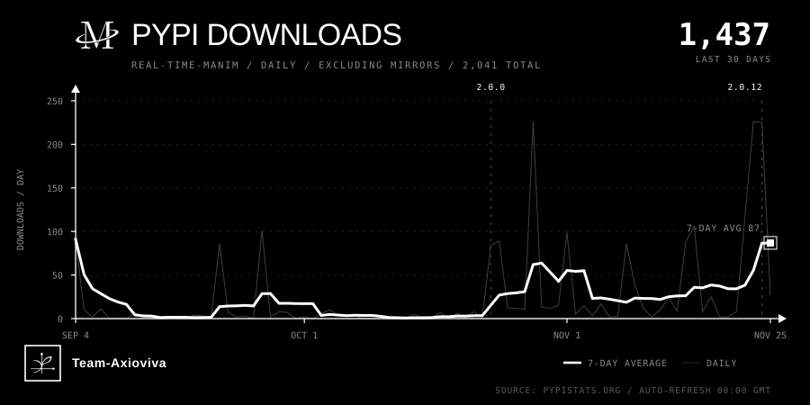

# Real-Time-Manim (RTM)

<p align="center">
  
</p>

<p align="center"><a href="README.md">English</a> · <a href="README.zh-CN.md">简体中文</a> · <a href="README.zh-TW.md">繁體中文</a> · <a href="README.ja.md">日本語</a> · <a href="README.ko.md">한국어</a> · <a href="README.hi.md">हिन्दी</a> · <b>Español</b> · <a href="README.pt-BR.md">Português</a> · <a href="README.fr.md">Français</a> · <a href="README.de.md">Deutsch</a> · <a href="README.ru.md">Русский</a></p>

Un **backend de renderizado en tiempo real para [ManimCE](https://www.manim.community/)
acelerado por Vulkan**. RTM impulsa el propio modelo `Mobject` / `Animation` de ManimCE mediante
una tubería Vulkan nativa, así que una misma escena puede verse **en vivo**, saltar a cualquier
fotograma al instante y grabarse a MP4 varias veces más rápido que el renderizador predeterminado.

**PyPI:** [pypi.org/project/real-time-manim](https://pypi.org/project/real-time-manim/)

> **Empieza aquí:** la [web del proyecto](https://team-axioviva.github.io/real-time-manim_website/)
> para una visión general, demos y el grafo wiki interactivo, y la
> [GitHub Wiki](https://github.com/Team-Axioviva/real-time-manim/wiki) para el recorrido a nivel
> de código.
> El manual completo en inglés está en [`RTM-Wiki/en_US/`](RTM-Wiki/en_US/README.md).
>
> **Agentes de IA:** empieza por [`RTM-Wiki/agent/README.md`](RTM-Wiki/agent/README.md) — toda la
> API condensada en una referencia fácil de grep, con [`gotchas.md`](RTM-Wiki/agent/gotchas.md),
> [`patterns.md`](RTM-Wiki/agent/patterns.md) y [`llms.txt`](llms.txt).


[](https://pypi.org/project/real-time-manim/)


[](https://pypi.org/project/real-time-manim/)


---

## Instalación

```bash
pip install real-time-manim
pip install "real-time-manim[typst]"   # opcional: backend Typst en proceso
```

El wheel incluye el binario de la plataforma (`vulkan_core.dll` en Windows,
`vulkan_core.dylib` en Apple Silicon); no hace falta compilar nada.
Necesitas una GPU/driver con Vulkan y `ffmpeg` en el `PATH` para grabar. **macOS** también
requiere MoltenVK en tiempo de ejecución (`brew install molten-vk`); en Mac Intel puedes compilar
el dylib con `bash native/build_mac.sh`.

---

## Inicio rápido

```python
from real_time_manim import Scene, Square, Create, Wait, BLUE, MLWindow
from real_time_manim.record import fast_record_scene

class Hello(Scene):
    def construct(self):
        win = MLWindow(960, 540)      # el tamaño se fuerza a 1920x1080
        win.scene = self              # obligatorio
        win.play(Create(Square(side_length=1.5, color=BLUE).set_fill(BLUE, 0.6)), run_time=1.0)
        win.play(Wait(0.5))
        win.close()                   # obligatorio: vacía y termina el codificador

fast_record_scene(Hello)              # -> ~/Downloads/output.mp4
```

`MLWindow` también es un gestor de contexto: `with MLWindow(...) as win:` lo cierra al salir
del bloque.

> **No hace falta instalar ManimCE por separado ni hacer `import manim`.** RTM incluye ManimCE
> **0.21.0** y reexporta todo su espacio de nombres. Importa `real_time_manim`, no `manim`, o la
> identidad de las clases se divide.

---

## Puntos destacados

- **Ventana en tiempo real** — 1920×1080 @ 60 fps, sin paso de exportación entre el código y la
  imagen.
- **Grabación rápida** — alrededor de **1.9–2.8×** más rápida que ManimCE Cairo. Las raíces
  estáticas se hornean en una textura por play y un `Wait` se codifica sin redibujar la escena.
- **Fotogramas en paralelo** — `jobs="auto"` reparte una escena larga entre workers;
  `prepare()` / `shared_prepare()` evitan repetir la preparación costosa en cada worker.
- **Búsqueda exacta de fotogramas** — cualquier fotograma de una escena preparada en O(1), con
  `FrameServer` / `FramePreview`.
- **3D con prueba de profundidad** — `MeshMobject` / `MeshBatch` / `MeshGroup` usan un búfer de
  profundidad GPU, así que las superficies que se cruzan o se autoocultan se resuelven píxel a
  píxel. Sombreado Manim horneado en CPU o material iluminado nativo.
- **Posprocesado** — bloom nativo opcional y tonemapping ACES/Reinhard.
- **ManimCE completo** — las escenas existentes funcionan sin cambios, incluido el código con
  `from manim import ...`.
- **Matemáticas sin LaTeX** — `MathTex` se enruta a un backend **Typst** en proceso
  (`RTM_TYPST=0` para desactivarlo).

**Novedades en 2.0.13:** actualización de documentación — página del paquete rediseñada, README
en chino e historia de PR recuperada en `PR_HISTORY.md`. Sin cambios en el motor: `native/` es
idéntico a 2.0.12 y `real_time_manim/` solo difiere en el valor de respaldo de la versión.

---

## 3D y posprocesado

`MeshMobject` es un mobject real de Manim, así que `shift`, `rotate` y `.animate` mueven la malla:

```python
import numpy as np
from real_time_manim import (
    ThreeDScene, Surface, MeshMobject, BLUE, UP, DEGREES, MLWindow,
)

class Terrain(ThreeDScene):
    def construct(self):
        win = MLWindow(1920, 1080)
        win.scene = self
        self.set_camera_orientation(phi=60 * DEGREES, theta=-45 * DEGREES)

        surf = Surface(
            lambda u, v: np.array([u, v, 0.35 * np.sin(2 * u) * np.cos(2 * v)]),
            u_range=(-2, 2), v_range=(-2, 2), resolution=(48, 48), fill_color=BLUE,
        ).set_stroke(width=0)

        mesh = MeshMobject.from_surface(surf, shade=True)   # iluminación estilo Manim
        self.add(mesh)
        win.play(mesh.animate.shift(0.4 * UP), run_time=1.0)
        win.close()
```

- Malla estática: `win.set_mesh(MeshBatch.from_surface(surf))` después de
  `surf.set_shade_in_3d(False)`. Es una instantánea en espacio de mundo; no hagas `add` de la
  superficie.
- Material nativo: `MeshMobject.from_surface(surf, lit=True)` más
  `win.set_mesh_light(ambient=0.25, diffuse=0.9, specular=0.4, shininess=48)`.
  `shade=True` y `lit=True` son mutuamente excluyentes.
- Bloom/tonemap: `win.set_post(bloom=0.8, threshold=0.75, tonemap="aces")`;
  `set_post(False)` lo desactiva y `RTM_POST=1` lo activa en todo.
- `from_surface()` solo hornea quads opacos; la malla no ordena transparencia por píxel.
  `MeshBatch.MAX_QUADS = 131072`, una malla nativa por fotograma.

---

## Tres formas de salida

| salida | API | notas |
| --- | --- | --- |
| **Ventana en vivo** | `MLWindow` | renderiza y se ve en tiempo real; sin archivo |
| **MP4** | `fast_record_scene` / `record_scene` | oculto offline (lo más rápido) o visible en tiempo real; `jobs=N` divide fotogramas |
| **Fotogramas PNG** | `FrameServer` / `FramePreview` | cualquier fotograma en cualquier `t` en O(1), o scrubbing de la línea de tiempo |

```python
from real_time_manim import MLWindow, Square, Create, FrameServer, FramePreview
from real_time_manim.record import fast_record_scene, record_scene

# 1. Ventana en vivo
win = MLWindow(1920, 1080)
win.scene = MyScene()
win.play(Create(Square()), run_time=1.0)
win.close()

# 2. MP4: oculto/offline (lo más rápido), paralelo o visible/tiempo real
fast_record_scene(MyScene)
fast_record_scene(MyScene, "out.mp4", jobs=4)
record_scene(MyScene, "live.mp4")

# 3. Fotogramas PNG: uno, una lista de tiempos o scrubbing interactivo
fs = FrameServer(MyScene)
fs.save_frame(2.5, "frame.png")
fs.export_frames("frames/", [0.0, 1.5, 3.0])
fs.close()
FramePreview(MyScene).run()
```

Los grabadores aceptan una subclase / instancia de `Scene` o un callable sin argumentos y
devuelven `{out_path, windows, files, with_audio}`. `jobs="auto"` solo divide escenas importables
de una sola ventana con al menos 240 fotogramas; mueve la preparación pura costosa a `prepare()`
para que cada worker la comparta.

---

## Restricciones

- La salida está **fijada a 1920×1080 @ 60 fps**; otros valores se corrigen con una línea
  `[rtm] forcing ...`.
- **Una ventana por proceso**; `win.scene = self` y `win.close()` son obligatorios (`atexit` es
  solo un respaldo de mejor esfuerzo y no puede informar errores del codificador).
- No hay CLI de `manim`: RTM es una biblioteca: `MLWindow`, los grabadores, `FrameServer`,
  `FramePreview`, `Timeline`.

---

## Contacto

Informes de errores y solicitudes: [abre un issue](https://github.com/Team-Axioviva/real-time-manim/issues).
Correo: **axioviva@gmail.com**.

---

## Licencia

[MIT](LICENSE). ManimCE, Vulkan y Typst pertenecen a sus respectivos proyectos.

---

## Downloads



Refreshed daily at 00:00 GMT (UTC) from [pypistats.org](https://pypistats.org/packages/real-time-manim).
The chart counts file downloads, not unique users.
