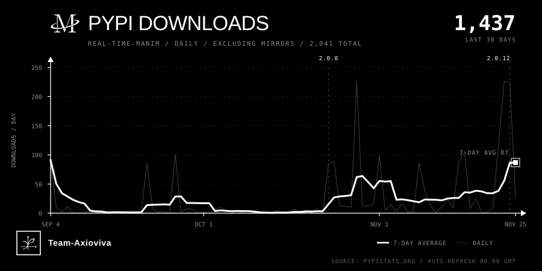

# Real-Time-Manim (RTM)

<p align="center">
  
</p>

<p align="center"><b>English</b> · <a href="README.zh-CN.md">简体中文</a> · <a href="README.zh-TW.md">繁體中文</a> · <a href="README.ja.md">日本語</a> · <a href="README.ko.md">한국어</a> · <a href="README.hi.md">हिन्दी</a> · <a href="README.es.md">Español</a> · <a href="README.pt-BR.md">Português</a> · <a href="README.fr.md">Français</a> · <a href="README.de.md">Deutsch</a> · <a href="README.ru.md">Русский</a></p>

A **Vulkan-accelerated, real-time rendering backend for [ManimCE](https://www.manim.community/)**.
RTM drives ManimCE's own `Mobject` / `Animation` model through a native Vulkan pipeline, so the same
scene can be watched **live**, seeked to any frame instantly, and recorded to MP4 several times
faster than the default renderer.

**PyPI:** [pypi.org/project/real-time-manim](https://pypi.org/project/real-time-manim/)

> **Start here:** the [project website](https://team-axioviva.github.io/real-time-manim_website/)
> for an overview, demos and the interactive wiki graph, and the
> [GitHub Wiki](https://github.com/Team-Axioviva/real-time-manim/wiki) for the source-level walkthrough.
> The complete English manual lives in [`RTM-Wiki/en_US/`](RTM-Wiki/en_US/README.md).
>
> **AI agents:** read [`RTM-Wiki/agent/README.md`](RTM-Wiki/agent/README.md) first — the whole API
> condensed into one greppable reference, with [`gotchas.md`](RTM-Wiki/agent/gotchas.md),
> [`patterns.md`](RTM-Wiki/agent/patterns.md) and [`llms.txt`](llms.txt).


[](https://pypi.org/project/real-time-manim/)


[](https://pypi.org/project/real-time-manim/)


---

## Install

```bash
pip install real-time-manim
pip install "real-time-manim[typst]"   # optional: in-process Typst math backend
```

The wheel bundles the platform binary (`vulkan_core.dll` on Windows, `vulkan_core.dylib` on Apple
Silicon); no native build step.
You need a Vulkan GPU/driver, and `ffmpeg` on `PATH` to record. **macOS** also needs MoltenVK at
runtime (`brew install molten-vk`); Intel Macs can build the dylib with `bash native/build_mac.sh`.

---

## Quick start

```python
from real_time_manim import Scene, Square, Create, Wait, BLUE, MLWindow
from real_time_manim.record import fast_record_scene

class Hello(Scene):
    def construct(self):
        win = MLWindow(960, 540)      # size is forced to 1920x1080
        win.scene = self              # required
        win.play(Create(Square(side_length=1.5, color=BLUE).set_fill(BLUE, 0.6)), run_time=1.0)
        win.play(Wait(0.5))
        win.close()                   # required: flushes and finishes the encoder

fast_record_scene(Hello)              # -> ~/Downloads/output.mp4
```

`MLWindow` is also a context manager: `with MLWindow(...) as win:` closes it on the way out.

> **No separate ManimCE install, and no `import manim`.** RTM bundles ManimCE **0.21.0** and
> re-exports its whole namespace. Import `real_time_manim` — not `manim` — or class identity splits.

---

## Highlights

- **Real-time window** — 1920×1080 @ 60 fps, no export step between code and picture.
- **Fast recording** — around **1.9–2.8×** faster than ManimCE Cairo. Static roots are baked into
  one texture per play, and a `Wait` is encoded without redrawing the scene.
- **Parallel frames** — `jobs="auto"` splits a long scene across workers; `prepare()` /
  `shared_prepare()` keep expensive setup from being repeated in each worker.
- **Frame-accurate seeking** — any frame of a prepared scene in O(1), via `FrameServer` /
  `FramePreview`.
- **Depth-tested 3D** — `MeshMobject` / `MeshBatch` / `MeshGroup` use a GPU depth buffer, so
  intersecting and self-occluding surfaces resolve per pixel. CPU-baked Manim shading or a native
  lit material.
- **Post-processing** — optional native bloom and ACES/Reinhard tonemapping.
- **Full ManimCE** — existing scenes run unchanged, including `from manim import ...` code.
- **Math without LaTeX** — `MathTex` routes to an in-process **Typst** backend (`RTM_TYPST=0` to
  disable).

**New in 2.0.13:** documentation refresh — a redesigned package page, a Chinese README, and the
recovered pull-request history in `PR_HISTORY.md`. No engine changes: `native/` is identical to
2.0.12, and `real_time_manim/` differs only in the version fallback.

---

## 3D and post-processing

`MeshMobject` is a real Manim mobject, so `shift`, `rotate` and `.animate` move the mesh:

```python
import numpy as np
from real_time_manim import (
    ThreeDScene, Surface, MeshMobject, BLUE, UP, DEGREES, MLWindow,
)

class Terrain(ThreeDScene):
    def construct(self):
        win = MLWindow(1920, 1080)
        win.scene = self
        self.set_camera_orientation(phi=60 * DEGREES, theta=-45 * DEGREES)

        surf = Surface(
            lambda u, v: np.array([u, v, 0.35 * np.sin(2 * u) * np.cos(2 * v)]),
            u_range=(-2, 2), v_range=(-2, 2), resolution=(48, 48), fill_color=BLUE,
        ).set_stroke(width=0)

        mesh = MeshMobject.from_surface(surf, shade=True)   # Manim-style lighting
        self.add(mesh)
        win.play(mesh.animate.shift(0.4 * UP), run_time=1.0)
        win.close()
```

- Static mesh: `win.set_mesh(MeshBatch.from_surface(surf))` after `surf.set_shade_in_3d(False)`.
  It is a world-space snapshot; do not `add` the surface too.
- Native material: `MeshMobject.from_surface(surf, lit=True)` plus
  `win.set_mesh_light(ambient=0.25, diffuse=0.9, specular=0.4, shininess=48)`.
  `shade=True` and `lit=True` are mutually exclusive.
- Bloom/tonemap: `win.set_post(bloom=0.8, threshold=0.75, tonemap="aces")`; `set_post(False)`
  disables it, `RTM_POST=1` enables it everywhere.
- `from_surface()` bakes opaque quads only; the mesh has no per-pixel transparency sort.
  `MeshBatch.MAX_QUADS = 131072`, one native mesh per frame.

---

## Three ways to output

| output | API | notes |
| --- | --- | --- |
| **Live window** | `MLWindow` | render and watch in real time; no file |
| **MP4** | `fast_record_scene` / `record_scene` | hidden offline (fastest) or visible real-time; `jobs=N` splits frames |
| **PNG frames** | `FrameServer` / `FramePreview` | any frame at any `t` in O(1), or scrub the timeline |

```python
from real_time_manim import MLWindow, Square, Create, FrameServer, FramePreview
from real_time_manim.record import fast_record_scene, record_scene

# 1. Live window
win = MLWindow(1920, 1080)
win.scene = MyScene()
win.play(Create(Square()), run_time=1.0)
win.close()

# 2. MP4: hidden/offline (fastest), parallel, or visible/real-time
fast_record_scene(MyScene)
fast_record_scene(MyScene, "out.mp4", jobs=4)
record_scene(MyScene, "live.mp4")

# 3. PNG frames: one frame, a list of times, or interactive scrubbing
fs = FrameServer(MyScene)
fs.save_frame(2.5, "frame.png")
fs.export_frames("frames/", [0.0, 1.5, 3.0])
fs.close()
FramePreview(MyScene).run()
```

The recorders accept a `Scene` subclass / instance / no-arg callable and return
`{out_path, windows, files, with_audio}`. `jobs="auto"` splits only for an importable single-window
scene of at least 240 frames; move expensive pure setup into `prepare()` so every worker shares it.

---

## Constraints

- Output is **fixed at 1920×1080 @ 60 fps**; other values are corrected with a `[rtm] forcing ...` line.
- **One window per process**; `win.scene = self` and `win.close()` are required (`atexit` is only a
  best-effort fallback and cannot report encoder errors).
- There is no `manim` CLI — RTM is a library: `MLWindow`, the recorders, `FrameServer`,
  `FramePreview`, `Timeline`.

---

## Contact

Bug reports and feature requests: [open an issue](https://github.com/Team-Axioviva/real-time-manim/issues).
Email: **axioviva@gmail.com**.


---

## License

[MIT](LICENSE). ManimCE, Vulkan and Typst belong to their respective projects.

---

## Downloads



Refreshed daily at 00:00 GMT (UTC) from [pypistats.org](https://pypistats.org/packages/real-time-manim).
The chart counts file downloads, not unique users.
