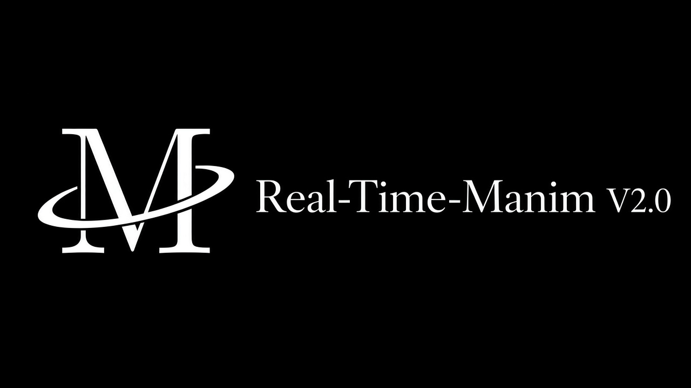
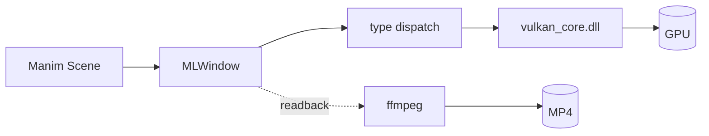

# Real-Time-Manim (RTM)

<p align="center">
  
</p>

A **Vulkan-accelerated, real-time rendering backend for [ManimCE](https://www.manim.community/)**.
RTM drives ManimCE's own `Mobject` / `Animation` model through a native Vulkan pipeline, so the same
scene can be watched **live in a window**, seeked to any frame instantly, and recorded to MP4
several times faster than the default renderer.


---

## Install

```bash
pip install real-time-manim
```

The Windows wheel bundles `vulkan_core.dll`, so there is no build step. You need a Vulkan-capable
GPU/driver, and `ffmpeg` on `PATH` to record video.

**macOS is supported as well** — build the dylib once, then install and run as usual:

```bash
brew install molten-vk          # MoltenVK provides the Vulkan layer on macOS
bash native/build_mac.sh        # -> dist/release/vulkan_core.dylib
```

---

## Quick start

```python
from real_time_manim import Scene, Square, BLUE
from real_time_manim.vulkan_bind import MLWindow, Create, Wait
from real_time_manim.record import fast_record_scene

class Hello(Scene):
    def construct(self):
        win = MLWindow(960, 540)      # a real-time window
        win.scene = self              # required
        sq = Square(side_length=1.5, color=BLUE).set_fill(BLUE, 0.6)
        win.play(Create(sq), run_time=1.0)
        win.play(Wait(0.5))
        win.close()                   # required

fast_record_scene(Hello)              # -> ~/Downloads/output.mp4
```

`MLWindow` opens the live window; `fast_record_scene` / `record_scene` record to MP4.

> **No separate ManimCE install, and no `import manim`.** RTM bundles ManimCE **0.21.0** and re-exports
> its whole namespace (`Scene`, every mobject and animation, the colours, the rate functions).
> Import `real_time_manim` — not `manim` — or class identity splits.

---

## Highlights

- **Real-time window** — 1920×1080 @ 60 fps, no export step between code and picture.
- **Fast recording** — around **1.9–2.8×** faster than ManimCE Cairo (a 15-second scene: 4.6–6.6 s
  versus 12.8–13.9 s).
- **Parallel frames** — `jobs="auto"` splits a long scene across worker processes.
- **Frame-accurate seeking** — any frame of a prepared scene in O(1), via `FramePreview`.
- **Full ManimCE** — existing scenes run unchanged, including `from manim import ...` code.
- **Math without LaTeX** — `MathTex` routes to an in-process **Typst** backend (`RTM_TYPST=0` to
  disable), with a content-hashed cache for both Typst and LaTeX.

---

## Recording

```python
fast_record_scene(MyScene)                    # offline readback -> ~/Downloads/output.mp4
fast_record_scene(MyScene, "out.mp4", jobs=4) # 4 worker processes
record_scene(MyScene, "live.mp4")             # capture a visible window in real time
```

Both accept a `Scene` subclass / instance / no-arg callable and return
`{out_path, windows, files, with_audio}`.

---

## Constraints

- Output is **fixed at 1920×1080 @ 60 fps**; any other value is corrected with a `[rtm] forcing ...` line.
- **One window per process**, and `win.scene = self` plus `win.close()` are required.
- There is no `manim` CLI — RTM is a library: `MLWindow`, the recorders, `FrameServer`, `FramePreview`.

---

## How it works



---

## Documentation

- [`RTM-Wiki/zh_CN/`](RTM-Wiki/zh_CN/README.md) — the full Chinese manual: 144 pages, one section per
  API, each with a rendered sample clip.
- [`RTM-Wiki/agent/`](RTM-Wiki/agent/README.md) — the same material condensed for AI agents.
- [**English wiki**](https://github.com/BEGINWITHF/real-time-manim/wiki) — a source-level walkthrough in
  eight chapters, from [01 Overview](https://github.com/BEGINWITHF/real-time-manim/wiki/01-Overview) to
  [08 Native Layer](https://github.com/BEGINWITHF/real-time-manim/wiki/08-Native-Layer).
- [`docs/`](docs/) — design notes.

---

## License

[MIT](LICENSE). ManimCE, Vulkan and Typst belong to their respective projects.
