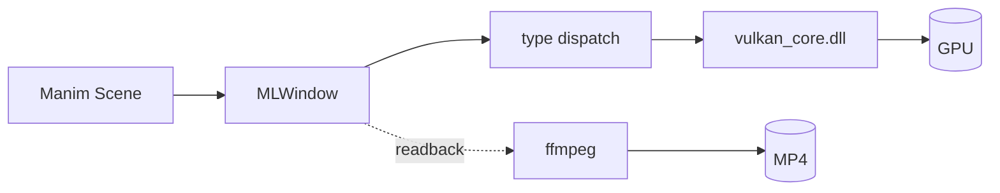

# Real-Time-Manim (RTM)

<p align="center">
  
</p>

A **Vulkan-accelerated, real-time rendering backend for [ManimCE](https://www.manim.community/)**.
RTM drives ManimCE's own `Mobject` / `Animation` model through a native Vulkan pipeline, so the same
scene can be watched **live in a window**, seeked to any frame instantly, and recorded to MP4
several times faster than the default renderer.


---

## Install

```bash
pip install real-time-manim
```

The Windows wheel bundles `vulkan_core.dll`; on macOS the installed package (the CI-built wheel, or
the sdist's platform build) bundles `vulkan_core.dylib` (Apple Silicon), so there is no native build
step. You need a Vulkan-capable GPU/driver, and `ffmpeg` on `PATH` to record video.

**macOS** needs MoltenVK at runtime — it provides the Vulkan layer on macOS:

```bash
brew install molten-vk
```

Intel Macs aren't covered by the bundled dylib: build it once and drop it next to the installed
`real_time_manim` package:

```bash
bash native/build_mac.sh        # -> dist/release/vulkan_core.dylib
```

---

## Quick start

```python
from real_time_manim import Scene, Square, BLUE
from real_time_manim.vulkan_bind import MLWindow, Create, Wait
from real_time_manim.record import fast_record_scene

class Hello(Scene):
    def construct(self):
        win = MLWindow(960, 540)      # a real-time window
        win.scene = self              # required
        sq = Square(side_length=1.5, color=BLUE).set_fill(BLUE, 0.6)
        win.play(Create(sq), run_time=1.0)
        win.play(Wait(0.5))
        win.close()                   # required

fast_record_scene(Hello)              # -> ~/Downloads/output.mp4
```

`MLWindow` opens the live window; `fast_record_scene` / `record_scene` record to MP4.

> **No separate ManimCE install, and no `import manim`.** RTM bundles ManimCE **0.21.0** and re-exports
> its whole namespace (`Scene`, every mobject and animation, the colours, the rate functions).
> Import `real_time_manim` — not `manim` — or class identity splits.

---

## Highlights

- **Real-time window** — 1920×1080 @ 60 fps, no export step between code and picture.
- **Fast recording** — around **1.9–2.8×** faster than ManimCE Cairo (a 15-second scene: 4.6–6.6 s
  versus 12.8–13.9 s). A static hold (`wait`) is drawn once and encoded for
  every frame, like ManimCE's frozen frame.
- **Parallel frames** — `jobs="auto"` splits a long scene across worker processes.
- **Frame-accurate seeking** — any frame of a prepared scene in O(1), via `FramePreview`.
- **Full ManimCE** — existing scenes run unchanged, including `from manim import ...` code.
- **Math without LaTeX** — `MathTex` routes to an in-process **Typst** backend (`RTM_TYPST=0` to
  disable), with a content-hashed cache for both Typst and LaTeX.

---

## Recording

```python
fast_record_scene(MyScene)                    # offline readback -> ~/Downloads/output.mp4
fast_record_scene(MyScene, "out.mp4", jobs=4) # 4 worker processes
record_scene(MyScene, "live.mp4")             # capture a visible window in real time
```

Both accept a `Scene` subclass / instance / no-arg callable and return
`{out_path, windows, files, with_audio}`.

---

## Caches

RTM caches three different things. They live in different places and are cleared
differently:

| what | where | saves | clear with |
| --- | --- | --- | --- |
| LaTeX / Typst formulas | `media/Tex` (+ your `tex_cache/`) | recompiling unchanged math | `clear_tex_cache()` |
| **text → SVG** (Pango) | `media/texts/<hash>.svg` | re-running Pango layout (~2 ms/string) | `clear_media()` (explicit) |
| parsed SVG → mobjects | process memory (`SVG_HASH_TO_MOB_MAP`) | `svgelements` parsing + one `VMobjectFromSVGPath` per glyph (4–20 ms/string) | process exit; `Text(use_svg_cache=False)` opts out |

```python
from real_time_manim import (
    restore_tex_cache, save_tex_cache, clear_tex_cache, clear_media,
)

restore_tex_cache("tex_cache")   # warm media/Tex from a saved formula cache
# ... run ...
save_tex_cache("tex_cache")      # stash newly compiled formulas
clear_tex_cache()                # wipe media/Tex + tex_cache/ (dry_run=True to preview)
clear_media()                    # wipe the whole media/ tree, including media/texts
```

`fast_record_scene(..., cleanup=True)` (the default) removes only the transient
output directories this run created (videos, images, partial movie files,
sections, logs); `media/Tex` and `media/texts` survive, so the on-disk caches
keep working across renders and never touch another process's `media/` tree.
Pass `cleanup=False` to keep this run's transient output as well. Use
`clear_media()` or `clear_tex_cache()` when you actually want to wipe the
caches. The in-memory SVG cache is capped at 256 entries and only starts
caching from the second build of the same string — identical labels are ~2.5×
faster to construct, while one-off strings (each `DecimalNumber` value) pay
nothing extra.

---

## Constraints

- Output is **fixed at 1920×1080 @ 60 fps**; any other value is corrected with a `[rtm] forcing ...` line.
- **One window per process**, and `win.scene = self` plus `win.close()` are required.
- There is no `manim` CLI — RTM is a library: `MLWindow`, the recorders, `FrameServer`, `FramePreview`.

---

## How it works



---

## Documentation

- [`RTM-Wiki/zh_CN/`](RTM-Wiki/zh_CN/README.md) — the full Chinese manual: 144 pages, one section per
  API, each with a rendered sample clip.
- [`RTM-Wiki/en_US/`](RTM-Wiki/en_US/README.md) — the same manual in English, with the sample clips
  re-rendered so the on-screen labels are English too.
- [`RTM-Wiki/agent/`](RTM-Wiki/agent/README.md) — the same material condensed for AI agents.
- [**English wiki**](https://github.com/BEGINWITHF/real-time-manim/wiki) — a source-level walkthrough in
  eight chapters, from [01 Overview](https://github.com/BEGINWITHF/real-time-manim/wiki/01-Overview) to
  [08 Native Layer](https://github.com/BEGINWITHF/real-time-manim/wiki/08-Native-Layer).

---

## License

[MIT](LICENSE). ManimCE, Vulkan and Typst belong to their respective projects.
