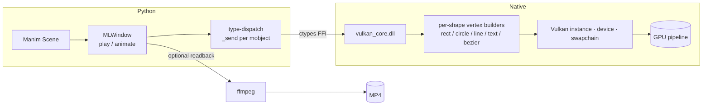

# Real-Time-Manim(RTM)

<p align="center">
  
</p>
A Vulkan-accelerated, real-time rendering backend for
[ManimCE](https://www.manim.community/). Instead of the default OpenGL/Cairo
renderer, `real-time-manim` draws every scene through a native Vulkan pipeline —
so you get a live, interactive window *and* fast GPU-accelerated video output,
all driven by ordinary Manim scenes.

> RTM(Real-Time-Manim) is a vulkan-based manim renderer boosting manim speed, making live-rendering available and compatible for rendering manim. Previous manim render focusing on Opengl ang Cairo renderer is CPU-based, making graphic rendering extremely slow and live-interaction unfeasible. RTM uses a refactored render pipeline (see flow chart below) to make live-render available for math animation, preparing for further development of Manteraction(a app for live interaction manim video creation, animation, and interaction.)


> **Audience.** This README is a short, user-facing guide. For the full picture —
> architecture, rendering internals, the animation system and building from
> source — see the [Wiki](https://github.com/BEGINWITHF/real-time-manim/wiki).

---

## Highlights

- **Live window.** Render Manim scenes in real time inside a `MLWindow`, not just
  to a rendered file.
- **GPU backend.** A bundled `vulkan_core.dll` replaces the Cairo/OpenGL raster
  path with a Vulkan vertex pipeline (rects, circles, lines, beziers, text, …).
- **One-line video capture.** `fast_record_scene(...)` records a scene to an MP4
  — offline and windowless by default — and `record_scene(...)` records against
  a live window. Output defaults to `~/Downloads`.
- **Auto-cleanup.** Transient `media/` artefacts are removed for you after a run.
- **LaTeX caching.** `Tex`/`MathTex` scenes reuse compiled SVGs so unchanged math
  is never recompiled.
- **All Manim Animations Supported** — everything mentioned in the "Animation" part in manim community is supported(we are going to support other features in the future).

---

## Install

real-time-manim is published to **PyPI**. With any Python 3.11+ on Windows
10/11:

```bash
pip install real-time-manim
```

The Windows wheel bundles everything you need to render (`vulkan_core.dll` and
the window icon), so no separate build step is required.

**macOS** is supported as well: the renderer loads a `vulkan_core.dylib` instead
of the Windows DLL, so build that once from source first:

```bash
brew install molten-vk          # MoltenVK provides the Vulkan layer on macOS
bash native/build_mac.sh        # -> dist/release/vulkan_core.dylib
```

Then install the package (from PyPI or this repo) and run as usual. See
[Building the DLL](https://github.com/BEGINWITHF/real-time-manim/wiki/Building-the-DLL)
for details.

> **Prerequisites at runtime:** a Vulkan-capable GPU/driver, and `ffmpeg` on your
> `PATH` if you want to record video.

---

## Quick start

Write a normal Manim `Scene`, open a window, and play. Then **record it to
`~/Downloads` with a single call**:

```python
from real_time_manim import Scene, Square, BLUE      # ManimCE comes bundled
from real_time_manim.vulkan_bind import MLWindow, Create, Wait
from real_time_manim.record import fast_record_scene

class Hello(Scene):
    def construct(self):
        win = MLWindow(960, 540)     # a real-time window opens
        win.scene = self
        sq = Square(side_length=1.5, color=BLUE).set_fill(BLUE, 0.6)
        win.play(Create(sq), run_time=1.0)
        win.play(Wait(0.5))
        win.close()

fast_record_scene(Hello)             # → C:\Users\<you>\Downloads\output.mp4
```

That's it — recording starts and stops around the scene automatically, and the
transient `media/` folder is cleaned up afterwards.

> **No ManimCE install, no `import manim`.** RTM bundles the ManimCE it drives
> (`real_time_manim/manim/`), and `import real_time_manim` re-exports its whole
> namespace — `Scene`, every mobject, every animation, the colours, the rate
> functions. Code written the old way (`from manim import ...`) keeps working
> too, and gets the very same classes.

---

## Core concepts

### `MLWindow` — the live renderer

`MLWindow(w, h)` opens a real-time Vulkan window. Inside a scene you bind it and
drive it with Manim animations:

```python
render = MLWindow(1280, 720)
render.scene = scene                 # bind the Manim scene
render.play(Create(sq))              # play any supported animation
render.close()
```

`render.play(...)` takes the same animations and keyword arguments you would pass
to Manim's `Scene.play` (`run_time`, `lag_ratio`, `rate_func`, …).

### Two recorders (`real_time_manim.record`)

| Function | Mode | Behaviour |
|----------|------|-----------|
| `fast_record_scene(scene, out_path=None, *, fps=60, hidden=True, overwrite=True, cleanup=True, jobs=None)` | offline | Fast framebuffer readback piped straight to ffmpeg. **No window** by default; runs at full speed. `jobs` splits long scenes across worker processes. |
| `record_scene(scene, out_path=None, *, fps=60, overwrite=True, cleanup=True)` | real-time | Captures a **live, visible** window in a background thread. |

Both accept a `Scene` subclass, a `Scene` instance, or a no-arg callable, and
return a dict `{out_path, windows, files}`. When `out_path` is omitted, output
lands at `~/Downloads/output.mp4` (a scene opening several windows gets
`_part2`, `_part3`, … suffixes). `cleanup=True` (default) deletes transient
manim `media/` after the run; set `cleanup=False` to keep it.

```python
fast_record_scene(MyScene)                       # ~/Downloads/output.mp4
fast_record_scene(MyScene, "preview.mp4")        # current dir, or pass a full path
fast_record_scene(MyScene, fps=60, hidden=False) # show the window while capturing
fast_record_scene(MyScene, jobs=4)               # 4 worker processes, split frames
record_scene(MyScene, "live.mp4", fps=30)        # record against a live window
```

**`jobs`** (fast record only) records a time-addressable scene with several
worker processes at once: the frame range is split into ordered blocks, each
worker renders its own block into its own mp4 and they are concatenated
losslessly, so the frame cost divides by the worker count and a long scene
records several times sooner. It needs a `Scene` *class* another process can
import (a directly-run script needs the usual `if __name__ == "__main__"` guard)
and it only pays off past a few seconds of video, because every worker pays its
own interpreter + GPU startup. So the default `jobs=None` records in one pass
with no probe at all, `jobs=N` asks for N workers, and `jobs="auto"` probes the
scene once and splits it only when that wins -- an importable, single-window
scene of at least 240 frames (4 s at 60 fps) across `min(4, cpus - 1)`
processes. `jobs=1` is the classic single pass (bit-for-bit identical to it).

Note that a split record renders frames from the timeline rather than replaying
`play()` calls, so a scene that relies on per-animation finishing hooks
(`finish()`, `clean_up_from_scene()` -- e.g. `FadeTransform`, whose ghost copy
is cleaned up there) can differ from a single-pass record. That is inherent to
rendering frames out of order, not a bug: use `jobs=None` for those scenes.

### Frame preview: any frame, instantly (`real_time_manim.preview`)

A window opens with **nothing playing**, plus an input bar docked right
underneath: type a frame, press Enter, and that frame is on screen -- no
pre-render, no replay. Preparing the scene runs `construct()` once *with
scheduling on* (nothing is drawn: `play` only records what each animation does),
and after that every seek is O(1) -- a few milliseconds wherever it lands. See
[`docs/2.0.0-time-addressable.md`](docs/2.0.0-time-addressable.md).

A seek replays animation state; mobjects driven purely by custom updaters (or
`TracedPath`) are exact when you step *forward* and approximate when you jump
backwards -- making those time-replayable is that document's P3.

```bash
python -m real_time_manim.preview 1                       # demo #1 from run.py
python -m real_time_manim.preview examples.scenes:DemoCreate --at 120
python -m real_time_manim.preview 1 --controls slider     # drag a scrubber instead
python -m real_time_manim.preview 1 --pos 1030,60         # keep previews apart
python -m real_time_manim.preview 1 --no-bar              # type in the terminal
```

The window forces itself to the front (plain `SetForegroundWindow` is denied to a
process that does not own the foreground, so it would otherwise open *behind*
whatever you have maximized).

The docked bar has two looks (`controls=`, or `--controls`):

| `controls` | Bar | How you move |
|------------|-----|--------------|
| `input` (default) | `[ frame ] [Jump] [Save PNG] [Quit]` | type a frame/time, press Enter or *Jump* |
| `slider` | `[=====\|====] [Save PNG] [Quit]` | drag the progress bar (it seeks as you drag) |

Either way the title bar shows `frame 123/347  t=2.050s`. In the text field:

| Input | Meaning |
|-------|---------|
| `120` / `120f` | frame 120 (frame numbers are the default unit) |
| `1.5` / `1.5s` | time 1.5 s |
| `+10` / `-1` | step that many frames from the current one |
| `s` | save the current frame as PNG (into `--out`, default `frames/`) |
| `p` | play forward from here (any input stops it) |
| `q` | quit |

The same grammar is read from the terminal when the bar is unavailable (macOS,
or `--no-bar`), so the mode never needs a GUI toolkit.
### LaTeX cache helpers (`real_time_manim.util`)

Rendering `MathTex`/`Tex` compiles each formula to an SVG. Cache the results so
unchanged math is reused instead of recompiled on every run:

```python
from real_time_manim.util import restore_tex_cache, save_tex_cache

restore_tex_cache("tex_cache")   # before rendering: warm manim's SVG dir
# ... run your Tex scene(s) ...
save_tex_cache("tex_cache")      # after: stash newly compiled SVGs
```

All helpers take explicit `media_dir`/`tex_subdir`, `only_ext`, `overwrite`,
`dry_run` and `verbose` knobs. `clear_media()` force-removes the transient media
folder (used automatically by the recorders).

---

## Animations

Import animations from `real_time_manim.vulkan_bind` (they re-export the
`real_time_manim.animations` package):

```python
from real_time_manim.vulkan_bind import (
    Create, Write, Transform, ReplacementTransform,
    FadeIn, FadeOut, FadeTransform, GrowFromCenter,
    Rotate, Rotating, ...
)
```

Highlights across categories:

- **Transforms** — `Transform`, `ReplacementTransform`, `FadeTransform`,
  `TransformMatchingShapes`, `TransformMatchingTex`
- **Drawing** — `Create`, `Uncreate`, `DrawBorderThenFill`,
  `ShowIncreasingSubsets`, `SpiralIn`
- **Fading** — `FadeIn`, `FadeOut`
- **Movement / scaling** — `MoveToTarget`, `MoveAlongPath`, `GrowFromCenter`,
  `GrowFromEdge`, `GrowFromPoint`, `GrowArrow`, `SpinInFromNothing`
- **Text** — `Write`, `Unwrite`, `TypeWithCursor`, `UntypeWithCursor`
- **Rotation** — `Rotate`, `Rotating`
- **Effects** — `ApplyWave`, `Circumscribe`, `Indicate`, `ShowPassingFlash`,
  `Blink`, `Homotopy`
- **Grouping / timing** — `AnimationGroup`, `Succession`

---

## How it works (in brief)



1. A `Scene` builds mobjects and calls `MLWindow.play(...)`.
2. The Python layer traverses the mobject tree and dispatches each shape to a
   type-specific sender.
3. Shapes cross a `ctypes` boundary into `vulkan_core.dll`, which emits vertices
   and submits them to a Vulkan pipeline.
4. Each frame is presented to the window — and can optionally be read back and
   piped to `ffmpeg` as an MP4.

Full details (frame lifecycle, coordinate system, animation internals, shape→DLL
mapping, build steps) live in the [Wiki](https://github.com/BEGINWITHF/real-time-manim/wiki).

---

## Repository layout

```
real-time-manim/
├── real_time_manim/            # the Python package
│   ├── window/                 #   MLWindow, split into mixins (core, paint, play, recording)
│   ├── render/                 #   mobject -> DLL senders (shapes/, text/, hooks, image, util)
│   ├── vulkan_bind.py          #   public facade re-exporting window/  (old import path)
│   ├── vulkan_shapes.py        #   shim -> render/shapes               (old import path)
│   ├── vulkan_text.py          #   shim -> render/text                 (old import path)
│   ├── vulkan_util.py          #   shim -> render/util                 (old import path)
│   ├── vulkan_image.py         #   shim -> render/image                (old import path)
│   ├── render_hooks.py         #   shim -> render/hooks                (old import path)
│   ├── record.py               #   one-call recorders (fast / real-time)
│   ├── util.py                 #   LaTeX cache + forced media cleanup
│   ├── rate_functions.py       #   easing functions
│   ├── animations/             #   ~40 animation modules
│   └── utils/
├── examples/                   # runnable examples
│   ├── scenes/                 #   82 demo scenes, one module per topic
│   └── timeline_seek.py        #   timeline seeking demo
├── tests/                      #   pytest suite
├── docs/                       #   design notes, feature lists, reports
├── native/                     # C/C++ Vulkan engine (vulkan_core.dll source)
├── logo.*                      # project logos
└── pyproject.toml
```

---

## Documentation & Wiki

- **[Home](https://github.com/BEGINWITHF/real-time-manim/wiki)** — overview and navigation
- **[Architecture](https://github.com/BEGINWITHF/real-time-manim/wiki/Architecture)** — layers and data flow
- **[Getting Started](https://github.com/BEGINWITHF/real-time-manim/wiki/Getting-Started)** — install, run, record
- **[API Reference](https://github.com/BEGINWITHF/real-time-manim/wiki/API-Reference)** — `MLWindow`, animations,
  recorders, cache helpers
- **[Animation Reference](https://github.com/BEGINWITHF/real-time-manim/wiki/Animation-Reference)** — supported animations
  with runnable examples
- **[Recording](https://github.com/BEGINWITHF/real-time-manim/wiki/Recording)** — recorders in depth
- **[Math Rendering](https://github.com/BEGINWITHF/real-time-manim/wiki/Math-Rendering)** — LaTeX vs. native Unicode mode
- **[Building the DLL](https://github.com/BEGINWITHF/real-time-manim/wiki/Building-the-DLL)** — compile `vulkan_core.dll`
- **[Internals](https://github.com/BEGINWITHF/real-time-manim/wiki/Internals)** — rendering pipeline, shape dispatch,
  design decisions

---

## License

[MIT](LICENSE) © real-time-manim contributors.

## Acknowledgments

- [ManimCE](https://www.manim.community/) — the mathematical animation engine
- [Vulkan](https://www.vulkan.org/) — the graphics API
