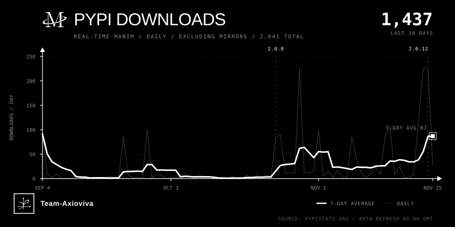

# Real-Time-Manim (RTM)

<p align="center">
  
</p>

<p align="center"><a href="README.md">English</a> · <b>简体中文</b> · <a href="README.zh-TW.md">繁體中文</a> · <a href="README.ja.md">日本語</a> · <a href="README.ko.md">한국어</a> · <a href="README.hi.md">हिन्दी</a> · <a href="README.es.md">Español</a> · <a href="README.pt-BR.md">Português</a> · <a href="README.fr.md">Français</a> · <a href="README.de.md">Deutsch</a> · <a href="README.ru.md">Русский</a></p>

基于 **Vulkan 加速的 [ManimCE](https://www.manim.community/) 实时渲染后端**。RTM 直接驱动
ManimCE 自己的 `Mobject` / `Animation` 数据模型，通过原生 Vulkan 管线渲染，因此同一个场景可以
**实时预览**、瞬间定位到任意一帧，并以比默认渲染器快数倍的速度录制为 MP4。

**PyPI：** [pypi.org/project/real-time-manim](https://pypi.org/project/real-time-manim/)

> **从这里开始：** 先看[项目官网](https://team-axioviva.github.io/real-time-manim_website/)
> （概览、演示和交互式 wiki 图谱），再看
> [GitHub Wiki](https://github.com/Team-Axioviva/real-time-manim/wiki)（源码级讲解）。
> 中文完整手册在 [`RTM-Wiki/zh_CN/`](RTM-Wiki/zh_CN/README.md)。
>
> **AI agent 请从这里开始：** 先读 [`RTM-Wiki/agent/README.md`](RTM-Wiki/agent/README.md)
> —— 整套 API 已压缩成一份可 grep 的参考，另有 [`gotchas.md`](RTM-Wiki/agent/gotchas.md)、
> [`patterns.md`](RTM-Wiki/agent/patterns.md) 和 [`llms.txt`](llms.txt)。


[](https://pypi.org/project/real-time-manim/)


[](https://pypi.org/project/real-time-manim/)


---

## 安装

```bash
pip install real-time-manim
pip install "real-time-manim[typst]"   # 可选：进程内 Typst 数学排版后端
```

wheel 内置对应平台的二进制（Windows 为 `vulkan_core.dll`，Apple Silicon 为
`vulkan_core.dylib`），无需本地编译。需要支持
Vulkan 的 GPU/驱动，录制视频还需要 `ffmpeg` 在 `PATH` 中。**macOS** 运行时还需要 MoltenVK
（`brew install molten-vk`）；Intel Mac 可用 `bash native/build_mac.sh` 自行构建 dylib。

---

## 快速开始

```python
from real_time_manim import Scene, Square, Create, Wait, BLUE, MLWindow
from real_time_manim.record import fast_record_scene

class Hello(Scene):
    def construct(self):
        win = MLWindow(960, 540)      # 尺寸会被强制为 1920x1080
        win.scene = self              # 必须绑定
        win.play(Create(Square(side_length=1.5, color=BLUE).set_fill(BLUE, 0.6)), run_time=1.0)
        win.play(Wait(0.5))
        win.close()                   # 必须调用：刷新并结束编码器

fast_record_scene(Hello)              # -> ~/Downloads/output.mp4
```

`MLWindow` 也可以作为上下文管理器：`with MLWindow(...) as win:` 会在退出时自动关闭。

> **无需单独安装 ManimCE，也不要 `import manim`。** RTM 内置 ManimCE **0.21.0** 并重新导出
> 整个命名空间。请导入 `real_time_manim`——不要先导入 `manim`，否则类身份会分裂。

---

## 亮点

- **实时窗口** —— 1920×1080 @ 60 fps，代码和画面之间没有导出步骤。
- **高速录制** —— 比 ManimCE Cairo 快约 **1.9–2.8×**。每次 play 的静态根节点会烘焙成一张
  纹理，`Wait` 不需要重绘场景。
- **并行帧** —— `jobs="auto"` 把长场景拆分到多个 worker；`prepare()` /
  `shared_prepare()` 避免每个 worker 重复做昂贵准备。
- **帧精确跳转** —— 已准备场景的任意一帧都是 O(1)，由 `FrameServer` / `FramePreview` 提供。
- **深度测试 3D** —— `MeshMobject` / `MeshBatch` / `MeshGroup` 使用 GPU 深度缓冲，相交和
  自遮挡表面按像素正确解析；支持 CPU 烘焙的 Manim 着色或原生光照材质。
- **后处理** —— 可选的 native bloom 与 ACES/Reinhard 色调映射。
- **完整 ManimCE** —— 现有场景无需修改，包括仍写着 `from manim import ...` 的代码。
- **无需 LaTeX 的数学** —— `MathTex` 会路由到进程内 **Typst** 后端（`RTM_TYPST=0` 可关闭）。

**2.0.13 新增：** 文档更新 —— 重做包页面、新增中文 README、恢复 `PR_HISTORY.md` 的 PR
历史。引擎没有改动：`native/` 与 2.0.12 完全一致，`real_time_manim/` 只改了版本号回退值。

---

## 3D 与后处理

`MeshMobject` 是真正的 Manim mobject，因此 `shift`、`rotate` 和 `.animate` 都会移动网格：

```python
import numpy as np
from real_time_manim import (
    ThreeDScene, Surface, MeshMobject, BLUE, UP, DEGREES, MLWindow,
)

class Terrain(ThreeDScene):
    def construct(self):
        win = MLWindow(1920, 1080)
        win.scene = self
        self.set_camera_orientation(phi=60 * DEGREES, theta=-45 * DEGREES)

        surf = Surface(
            lambda u, v: np.array([u, v, 0.35 * np.sin(2 * u) * np.cos(2 * v)]),
            u_range=(-2, 2), v_range=(-2, 2), resolution=(48, 48), fill_color=BLUE,
        ).set_stroke(width=0)

        mesh = MeshMobject.from_surface(surf, shade=True)   # Manim 风格光照
        self.add(mesh)
        win.play(mesh.animate.shift(0.4 * UP), run_time=1.0)
        win.close()
```

- 静态网格：先 `surf.set_shade_in_3d(False)`，再
  `win.set_mesh(MeshBatch.from_surface(surf))`。它是世界空间快照，不要再 `add` 这个 Surface。
- 原生材质：`MeshMobject.from_surface(surf, lit=True)` 加
  `win.set_mesh_light(ambient=0.25, diffuse=0.9, specular=0.4, shininess=48)`。
  `shade=True` 与 `lit=True` 互斥。
- Bloom/tonemap：`win.set_post(bloom=0.8, threshold=0.75, tonemap="aces")`；
  `set_post(False)` 关闭，`RTM_POST=1` 全局开启。
- `from_surface()` 只烘焙不透明四边形；mesh 没有逐像素透明排序。`MeshBatch.MAX_QUADS = 131072`，每帧一个原生网格批次。

---

## 三种产出方式

| 产出 | API | 说明 |
| --- | --- | --- |
| **实时窗口** | `MLWindow` | 直接实时渲染观看，不写文件 |
| **MP4** | `fast_record_scene` / `record_scene` | 隐藏离线（最快）或可见实时；`jobs=N` 并行拆帧 |
| **PNG 帧** | `FrameServer` / `FramePreview` | 任意 `t` 的帧 O(1) 导出，或交互式拖动预览 |

```python
from real_time_manim import MLWindow, Square, Create, FrameServer, FramePreview
from real_time_manim.record import fast_record_scene, record_scene

# 1. 实时窗口
win = MLWindow(1920, 1080)
win.scene = MyScene()
win.play(Create(Square()), run_time=1.0)
win.close()

# 2. MP4：隐藏离线（最快）、并行，或可见实时
fast_record_scene(MyScene)
fast_record_scene(MyScene, "out.mp4", jobs=4)
record_scene(MyScene, "live.mp4")

# 3. PNG 帧：单帧、一组时间点，或交互式拖动
fs = FrameServer(MyScene)
fs.save_frame(2.5, "frame.png")
fs.export_frames("frames/", [0.0, 1.5, 3.0])
fs.close()
FramePreview(MyScene).run()
```

录制器都接受 `Scene` 子类 / 实例 / 无参可调用对象，返回
`{out_path, windows, files, with_audio}`。`jobs="auto"` 只对可导入、单窗口且至少 240 帧的
场景拆分；把昂贵的纯准备逻辑放进 `prepare()`，所有 worker 即可共享。

---

## 约束

- 输出**固定为 1920×1080 @ 60 fps**；其他值会被修正并打印 `[rtm] forcing ...`。
- **每个进程只能有一个窗口**；必须设置 `win.scene = self` 并调用 `win.close()`
  （`atexit` 只是尽力而为的回退，无法报告编码器错误）。
- 没有 `manim` CLI——RTM 是库：`MLWindow`、录制器、`FrameServer`、`FramePreview`、`Timeline`。

---

## 联系

Bug 与功能请求：[提交 issue](https://github.com/Team-Axioviva/real-time-manim/issues)。
邮箱：**axioviva@gmail.com**。

---

## 许可证

[MIT](LICENSE)。ManimCE、Vulkan 和 Typst 归各自项目所有。

---

## Downloads



Refreshed daily at 00:00 GMT (UTC) from [pypistats.org](https://pypistats.org/packages/real-time-manim).
The chart counts file downloads, not unique users.
