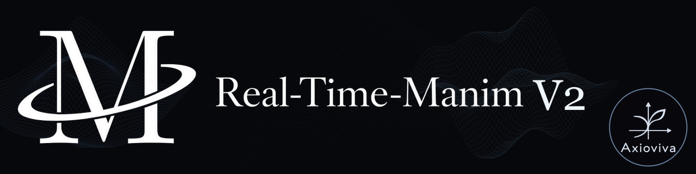

# Real-Time-Manim (RTM)

<p align="center">
  
</p>

<p align="center"><a href="README.md">English</a> · <a href="README.zh-CN.md">简体中文</a> · <b>繁體中文</b> · <a href="README.ja.md">日本語</a> · <a href="README.ko.md">한국어</a> · <a href="README.hi.md">हिन्दी</a> · <a href="README.es.md">Español</a> · <a href="README.pt-BR.md">Português</a> · <a href="README.fr.md">Français</a> · <a href="README.de.md">Deutsch</a> · <a href="README.ru.md">Русский</a></p>

一個以 **Vulkan 加速的 [ManimCE](https://www.manim.community/) 即時渲染後端**。RTM 直接驅動
ManimCE 自己的 `Mobject` / `Animation` 資料模型，透過原生 Vulkan 管線渲染，因此同一個場景可以
**即時預覽**、瞬間定位到任意影格，並以比預設渲染器快數倍的速度錄製為 MP4。

**PyPI：** [pypi.org/project/real-time-manim](https://pypi.org/project/real-time-manim/)

> **從這裡開始：** 先看[專案官網](https://team-axioviva.github.io/real-time-manim_website/)
> （概覽、示範和互動式 wiki 圖譜），再看
> [GitHub Wiki](https://github.com/Team-Axioviva/real-time-manim/wiki)（原始碼級講解）。
> 完整手冊目前以簡體中文提供：[`RTM-Wiki/zh_CN/`](RTM-Wiki/zh_CN/README.md)。
>
> **AI agent 請從這裡開始：** 先讀 [`RTM-Wiki/agent/README.md`](RTM-Wiki/agent/README.md)
> —— 整套 API 已壓縮成一份可 grep 的參考，另有 [`gotchas.md`](RTM-Wiki/agent/gotchas.md)、
> [`patterns.md`](RTM-Wiki/agent/patterns.md) 和 [`llms.txt`](llms.txt)。


[](https://pypi.org/project/real-time-manim/)


[](https://pypi.org/project/real-time-manim/)


---

## 安裝

```bash
pip install real-time-manim
pip install "real-time-manim[typst]"   # 可選：行程內 Typst 數學排版後端
```

wheel 內含對應平台的原生二進位（Windows 為 `vulkan_core.dll`，Apple Silicon 為
`vulkan_core.dylib`），無需在本機編譯。
需要支援 Vulkan 的 GPU/驅動程式，錄影還需要 `ffmpeg` 在 `PATH` 中。**macOS** 執行時還需要
MoltenVK（`brew install molten-vk`）；Intel Mac 可用 `bash native/build_mac.sh` 自行建置 dylib。

---

## 快速開始

```python
from real_time_manim import Scene, Square, Create, Wait, BLUE, MLWindow
from real_time_manim.record import fast_record_scene

class Hello(Scene):
    def construct(self):
        win = MLWindow(960, 540)      # 尺寸會強制為 1920x1080
        win.scene = self              # 必須綁定
        win.play(Create(Square(side_length=1.5, color=BLUE).set_fill(BLUE, 0.6)), run_time=1.0)
        win.play(Wait(0.5))
        win.close()                   # 必須呼叫：刷新並結束編碼器

fast_record_scene(Hello)              # -> ~/Downloads/output.mp4
```

`MLWindow` 也可以作為上下文管理器：`with MLWindow(...) as win:` 會在退出時自動關閉。

> **不需要另外安裝 ManimCE，也不要 `import manim`。** RTM 內建 ManimCE **0.21.0** 並重新匯出
> 完整命名空間。請匯入 `real_time_manim`——不要先匯入 `manim`，否則類別身分會分裂。

---

## 亮點

- **即時視窗** —— 1920×1080 @ 60 fps，程式碼與畫面之間沒有匯出步驟。
- **高速錄製** —— 比 ManimCE Cairo 快約 **1.9–2.8×**。每次 play 的靜態根節點會烘焙成一張
  紋理，`Wait` 不需要重繪場景。
- **平行影格** —— `jobs="auto"` 會把長場景拆分到多個 worker；`prepare()` /
  `shared_prepare()` 避免每個 worker 重複做昂貴的準備。
- **影格精確跳轉** —— 已準備場景的任意影格都是 O(1)，由 `FrameServer` / `FramePreview` 提供。
- **深度測試 3D** —— `MeshMobject` / `MeshBatch` / `MeshGroup` 使用 GPU 深度緩衝區，相交與
  自遮擋表面會逐像素正確解析。支援 CPU 烘焙的 Manim 著色或原生光照材質。
- **後處理** —— 可選的原生 bloom 與 ACES/Reinhard 色調映射。
- **完整 ManimCE** —— 現有場景無需修改，包括仍寫著 `from manim import ...` 的程式碼。
- **無需 LaTeX 的數學** —— `MathTex` 會路由到行程內 **Typst** 後端（`RTM_TYPST=0` 可關閉）。

**2.0.13 新增：** 文件更新 —— 重新設計套件頁面、新增簡體中文 README、還原 `PR_HISTORY.md` 的 PR
歷史。引擎沒有變更：`native/` 與 2.0.12 完全相同，`real_time_manim/` 只改了版本號回退值。

---

## 3D 與後處理

`MeshMobject` 是真正的 Manim mobject，因此 `shift`、`rotate` 和 `.animate` 會移動網格：

```python
import numpy as np
from real_time_manim import (
    ThreeDScene, Surface, MeshMobject, BLUE, UP, DEGREES, MLWindow,
)

class Terrain(ThreeDScene):
    def construct(self):
        win = MLWindow(1920, 1080)
        win.scene = self
        self.set_camera_orientation(phi=60 * DEGREES, theta=-45 * DEGREES)

        surf = Surface(
            lambda u, v: np.array([u, v, 0.35 * np.sin(2 * u) * np.cos(2 * v)]),
            u_range=(-2, 2), v_range=(-2, 2), resolution=(48, 48), fill_color=BLUE,
        ).set_stroke(width=0)

        mesh = MeshMobject.from_surface(surf, shade=True)   # Manim 風格光照
        self.add(mesh)
        win.play(mesh.animate.shift(0.4 * UP), run_time=1.0)
        win.close()
```

- 靜態網格：先 `surf.set_shade_in_3d(False)`，再
  `win.set_mesh(MeshBatch.from_surface(surf))`。它是世界空間快照，不要再 `add` 這個 Surface。
- 原生材質：`MeshMobject.from_surface(surf, lit=True)` 加
  `win.set_mesh_light(ambient=0.25, diffuse=0.9, specular=0.4, shininess=48)`。
  `shade=True` 與 `lit=True` 互斥。
- Bloom/tonemap：`win.set_post(bloom=0.8, threshold=0.75, tonemap="aces")`；
  `set_post(False)` 關閉，`RTM_POST=1` 全域開啟。
- `from_surface()` 只烘焙不透明四邊形；mesh 沒有逐像素透明排序。
  `MeshBatch.MAX_QUADS = 131072`，每幀一個原生網格批次。

---

## 三種產出方式

| 產出 | API | 說明 |
| --- | --- | --- |
| **即時視窗** | `MLWindow` | 直接即時渲染觀看，不寫檔案 |
| **MP4** | `fast_record_scene` / `record_scene` | 隱藏離線（最快）或可見即時；`jobs=N` 平行拆幀 |
| **PNG 影格** | `FrameServer` / `FramePreview` | 任意 `t` 的影格 O(1) 匯出，或互動式拖動預覽 |

```python
from real_time_manim import MLWindow, Square, Create, FrameServer, FramePreview
from real_time_manim.record import fast_record_scene, record_scene

# 1. 即時視窗
win = MLWindow(1920, 1080)
win.scene = MyScene()
win.play(Create(Square()), run_time=1.0)
win.close()

# 2. MP4：隱藏離線（最快）、平行，或可見即時
fast_record_scene(MyScene)
fast_record_scene(MyScene, "out.mp4", jobs=4)
record_scene(MyScene, "live.mp4")

# 3. PNG 影格：單張、時間清單，或互動式拖動
fs = FrameServer(MyScene)
fs.save_frame(2.5, "frame.png")
fs.export_frames("frames/", [0.0, 1.5, 3.0])
fs.close()
FramePreview(MyScene).run()
```

錄製器接受 `Scene` 子類 / 實例 / 無參數 callable，回傳
`{out_path, windows, files, with_audio}`。`jobs="auto"` 只會對可匯入、單視窗、至少 240 幀的
場景拆分；把昂貴的純資料準備移到 `prepare()`，讓每個 worker 共用。

---

## 限制

- 輸出**固定為 1920×1080 @ 60 fps**；其他值會被修正並印出 `[rtm] forcing ...`。
- **每個行程只能有一個視窗**；必須設定 `win.scene = self` 並呼叫 `win.close()`
  （`atexit` 只是盡力而為的回退，無法回報編碼器錯誤）。
- 沒有 `manim` CLI——RTM 是函式庫：`MLWindow`、錄製器、`FrameServer`、`FramePreview`、
  `Timeline`。

---

## 聯絡

Bug 與功能請求：[提交 issue](https://github.com/Team-Axioviva/real-time-manim/issues)。
電子郵件：**axioviva@gmail.com**。

---

## 授權

[MIT](LICENSE)。ManimCE、Vulkan 與 Typst 歸各自專案所有。
